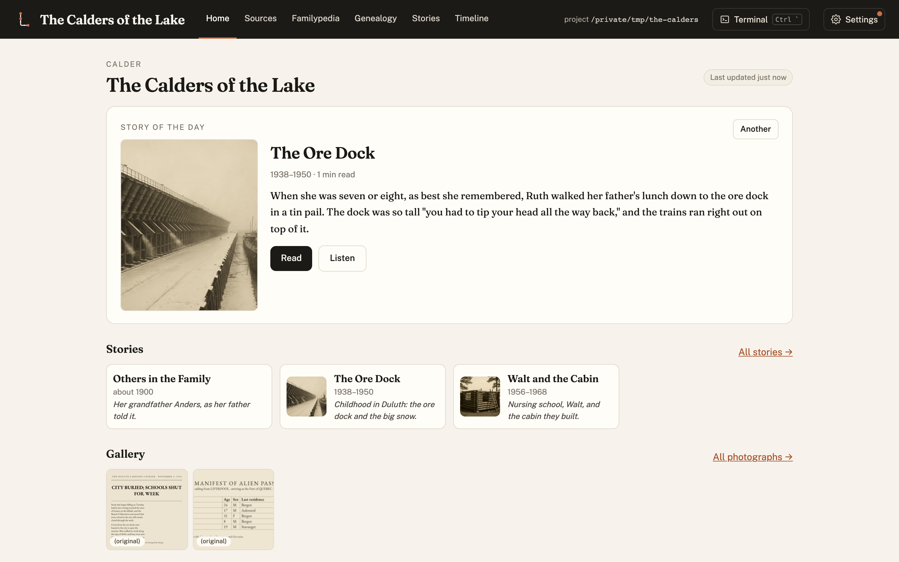
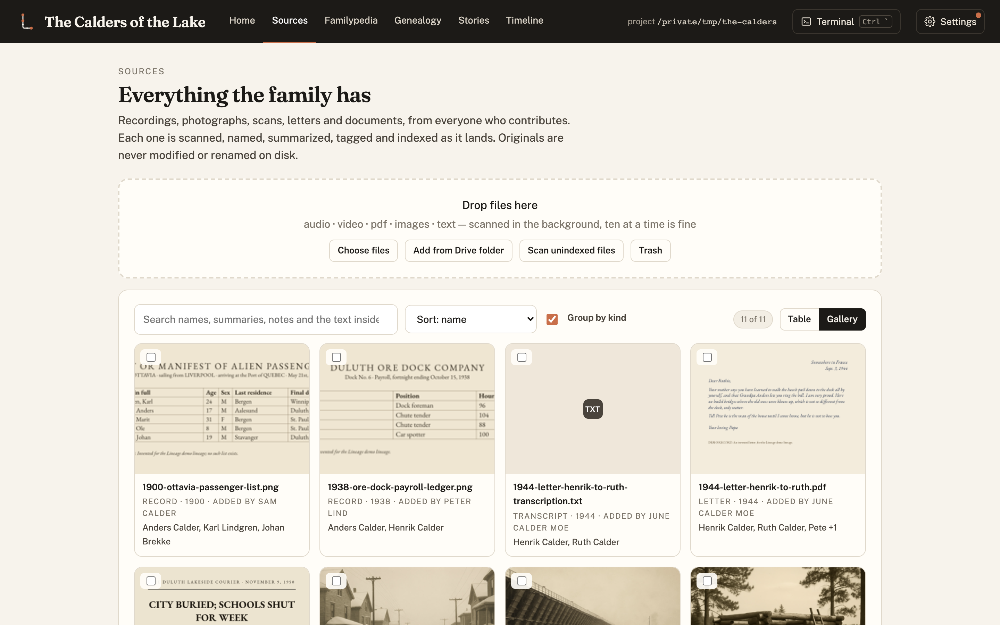
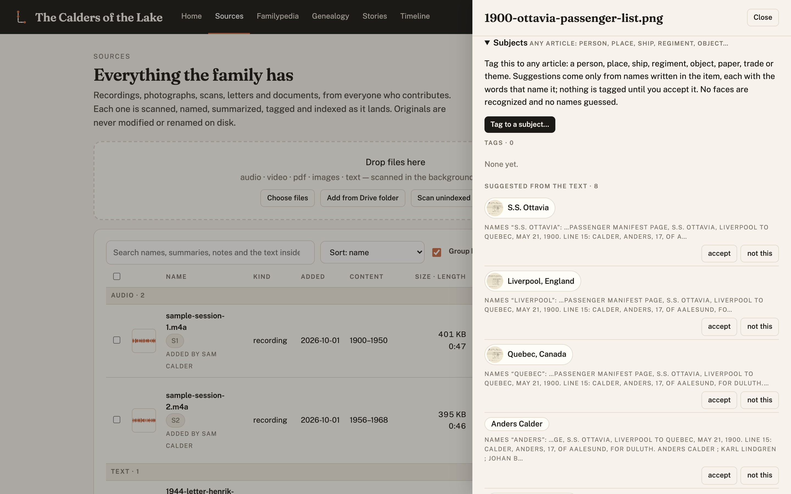
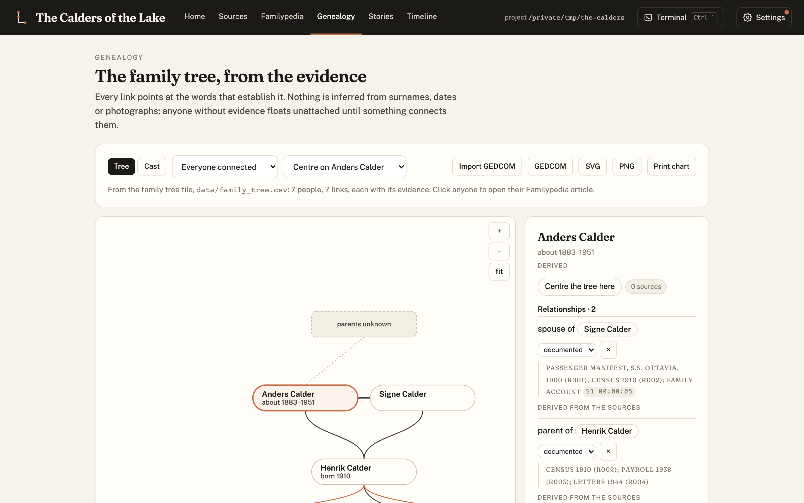
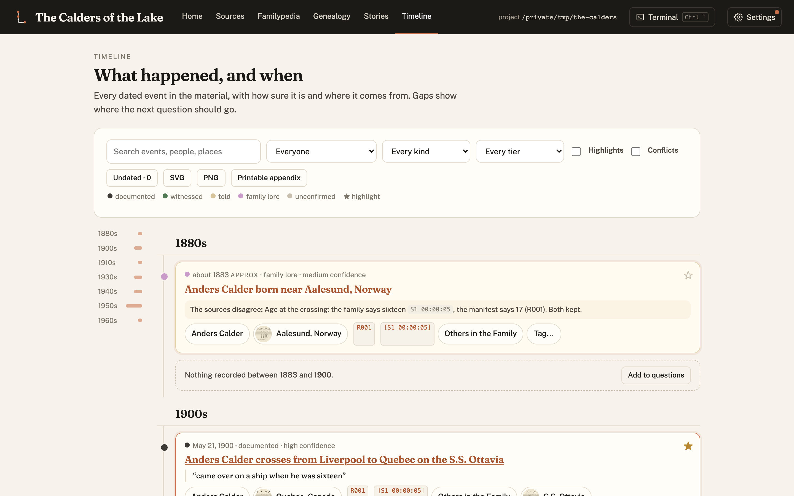
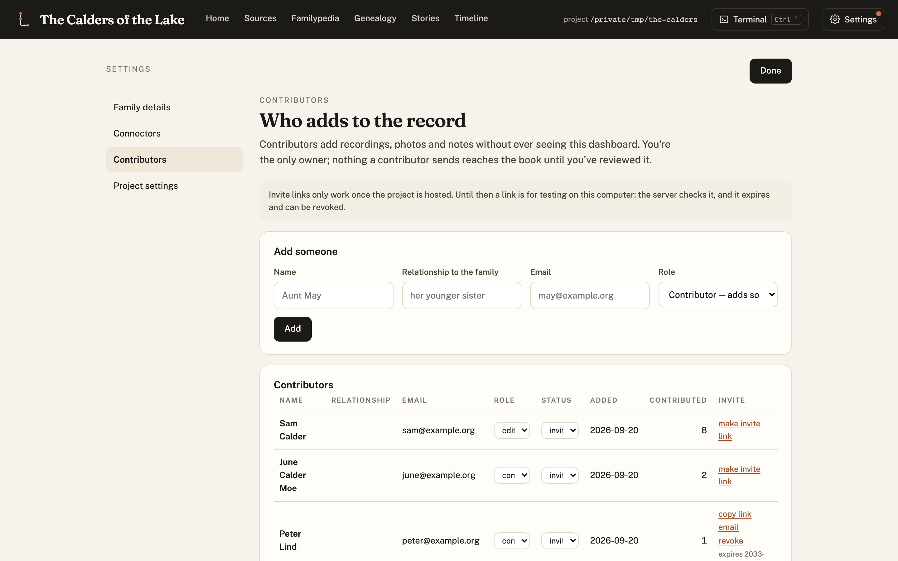

# Getting started with Lineage

New to Lineage? This page explains what it is, what you need, and what a first week with it looks
like. No technical background is assumed. When you want the commands, the
[Quickstart](../quickstart/) has them on one page.

## What Lineage is

Every family has its history scattered: a grandparent's memories, a shoebox of letters, photographs
in three houses, a census entry nobody has looked up. Lineage gathers it into **one record that you
own**, checks it against public records, and keeps every fact tied to where it came from.

From that record it builds:

- a **Familypedia**, an encyclopedia with an article for every person, place, ship, company and
  event the material names;
- a **genealogy**, where every line points at the evidence for it;
- a **timeline**, coloured by how well each date is known;
- **stories**, written from the recordings, readable as book pages, downloadable, and narrated;
- and, at the end, a **printed book**.

Everything is plain files (text, spreadsheets, the original scans) in a folder on your computer.
The record outlives any app, including this one.

## What you need

1. **Something to start from.** One recorded conversation with a relative is enough. So is a box of
   photographs, or a single family Bible.
2. **A Mac or Linux computer.**
3. **A Claude subscription and [Claude Code](https://claude.com/claude-code).** Claude does the
   reading, transcribing, researching and writing, following Lineage's rules. You talk to it in plain
   English.
4. **About an hour** for the first setup.

## Step 1: look around the demo

Before using your own family, open the demo. It shows a finished record for the Calders, an invented
family, so you can see where you are heading. [Open the live demo](../demo/) in your browser, or run
`make demo` on your own machine (see the [Quickstart](../quickstart/)).

The **Home** tab shows the story of the day, the relatives, and what needs a person's decision.

## Step 2: add what the family has

Everything comes in through **Sources**. Drop in recordings, photographs, letters, PDFs or links.
Lineage reads each one, writes a summary, and tags it with the people, places and dates in it. It
never renames or alters your originals.

Click any item to see what was found in it and correct anything that is wrong.

## Step 3: let the record build itself

Ask Claude Code to transcribe the recordings and build the record. The **Familypedia** fills in with
an article for every subject. Each sentence carries a footnote, so you can always see whether a fact
came from a recording ("told"), from a document ("what the records show"), or from family lore.

Articles are not only about people. Ships, regiments, companies and places get their own.

The **Genealogy** draws the family tree. No line is drawn without evidence behind it.

The **Timeline** puts every dated event in order, and flags where two sources disagree.

## Step 4: read the stories

From the recordings, Lineage writes stories in the family's own voice, with quotations kept exact
and every paragraph cited. Each one can be read as finished book pages, downloaded as a PDF, or
listened to as narration.

Open a story to read it as pages, with every paragraph's sources beside it.

## Step 5: invite the family

Relatives can add what they have, too: their own recordings, photographs and corrections. Everything
they add is reviewed before it counts.

## Step 6: share it, or print it

When you are ready, Lineage publishes a read-only website of the record, like the
[demo](../demo/), and builds a printed book with a table of contents, an index and a list of every
source. You decide what is public. Living relatives can be left out, and private passages stay
private.

## Three rules Lineage always keeps

- **Nothing is invented.** Anything a writer would like to add is held as a "bridge" until a person
  approves it.
- **Contradictions are kept.** When the family remembers one date and a record says another, both
  are shown.
- **Pictures are honest.** A generated illustration is always marked as one, and is never used as a
  person's photograph.

## Where to go next

- [Quickstart](../quickstart/): the commands, on one page.
- [The tour](../tour/): every screen of the dashboard.
- [The how-to guide](HOWTO.md): everything, in detail.
- [The blog](../blog/): what's new and how Lineage came to be.
