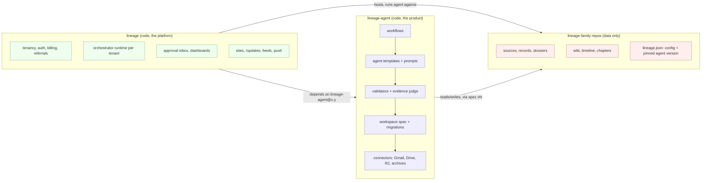
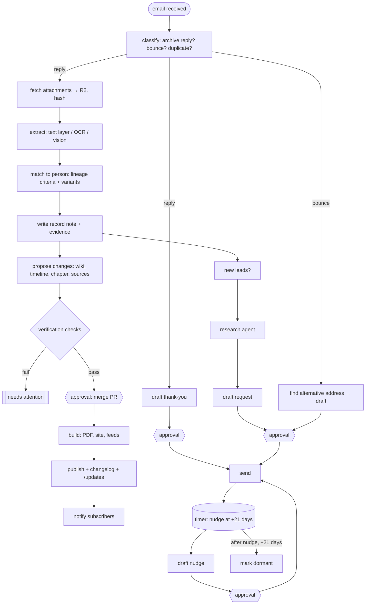
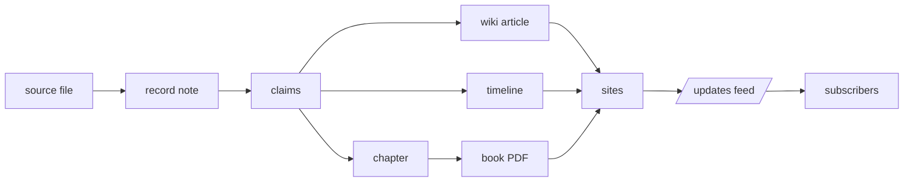

# Lineage platform architecture

**Status:** proposal, v0.1 (18 October 2026). Owner: Rex St. John.
**Scope:** how Lineage becomes a platform that hosts many family lineages, how the research agent becomes a separate,
versioned product, and how _The Book of Daniel_ moves from a hand-run project into the first hosted lineage.

The three goals:

1. **Many lineages, one platform.** Lineage hosts any number of family lineages, each isolated, each with its own site,
   archivist, subscribers and approvals.
2. **The research agent is its own repo.** The agent loop (gather, ingest, verify, propose, request, follow up, publish)
   lives in `lineage-agent`, released and versioned on its own, so it can be iterated without touching any family's data.
3. **The Book of Daniel becomes tenant #1.** Its content moves to a content-only repo, its custom scripts become agent
   features or configuration, and it keeps publishing throughout the move.

---

## 1. What we learned running it by hand

_The Book of Daniel_ has been run as a long Claude Code session with scheduled prompts. Over three weeks of daily work the
same chain repeated: an archive replies → attachments saved → records transcribed → dossier, Familypedia, timeline and
chapter updated → PDF rebuilt → sites published → changelog → thank-you and follow-up e-mails → new leads → research agents
→ more requests. Almost every failure came from the glue, not the research:

| Failure seen | Root cause | Fix in this design |
|---|---|---|
| Gmail and Drive tokens expired every few days | Google OAuth app in **Testing** mode (refresh tokens expire after 7 days) | Published OAuth app per platform; per-tenant tokens in a vault (§5.4) |
| 11 MB attachments could not be fetched | MCP connector response-size limits | Agent calls the Gmail API directly, streams attachments to R2 (§4.3) |
| Duplicate e-mails ingested twice | No idempotency | Message-ID and content-hash keys on every step (§4.6) |
| Source id collisions (two `S479`s), CSV line-ending churn | Flat files edited by several agents at once | Operational state in Postgres; content changes as PRs with CI checks (§5.2, §4.5) |
| "Follow up on 30 Oct" lived in a CSV column | No durable timers | Orchestrator timers (`sleepUntil`) (§5.1) |
| Sites behind bot checks, phone calls, cheques | Work only a person can do | First-class human task queue (§4.7) |
| Worktree + clone + rsync to push | Two copies of one book | One content repo per lineage (§6) |
| Book-specific scripts forked from core | No contract between engine and book | A versioned workspace spec (§3) |

---

## 2. Three layers, three kinds of repo



| Repo | Contains | Never contains | Released as |
|---|---|---|---|
| **`lineage-agent`** | Workflow definitions, agent templates and versioned prompts, validators, the evidence judge, the workspace spec and its migrations, connectors, the CLI, the Claude Code plugin | Any family's data or secrets | Package + container + Claude Code plugin, semver |
| **`lineage`** (this repo) | Hosting, tenancy, auth, billing and referrals, the orchestrator runtime, the approval inbox and dashboards, the public sites, `/updates`, feeds, digest and push | Research logic (it calls the agent) | Deployed service |
| **`lineage-<family>`** e.g. `lineage-book-of-daniel` | Content only: sources (or pointers to R2), records, dossiers, wiki, timeline, chapters, photos index, the requests ledger export, `lineage.json` | Scripts, overrides, secrets | Git history + book editions (GitHub Releases) |

The agent works on **any repo that conforms to the workspace spec**. The platform hosts **any conforming repo**. A family can
also run the agent locally (CLI or Claude Code plugin) with no platform at all: same code, two distribution channels.

---

## 3. The workspace spec (the contract)

The spec is the real product boundary: it defines what a lineage *is*. Version 1 is written from what _The Book of Daniel_
already is, and every family repo declares the version it conforms to.

### 3.1 Layout (v1)

```
lineage.json                 config: tenant id, people, chapters, rules, pinned agent + spec versions, publish targets
sources/                     originals or R2 pointers (*.r2.json: key, sha256, size, media type)
transcript/                  interviews: raw, verbatim, clean; sessions.csv
facts/
  records/<person>/          one note per record or archive reply (provenance header required)
  timeline.csv               events with date_basis, precision, confidence, conflicts
  people/                    person facts
dossiers/<chapter>/          SOURCES.csv, EVIDENCE.md, RESEARCH-LOG.md, REQUEST-*.md (archivist briefs)
data/
  wiki/<slug>.md             Familypedia articles (infobox front matter + footnoted prose)
  chapters.csv               chapter ids, files, parts, status
  stale_stories.json         chapters needing a rewrite
  portraits.csv, image_catalog.csv
chapters/ or pilot/          chapter sources (Typst or Markdown)
requests/                    exported ledger snapshot (the live ledger is in Postgres)
outbox/                      proposed outward actions: emails/, forms/, orders/ (merging = approval, §4.4)
CHANGELOG.md, VERSION        editions
```

### 3.2 Schemas

JSON Schema for every structured file: `sources.csv`, `timeline.csv`, `records` front matter, wiki front matter, `outbox`
items, `lineage.json`. Ids are minted by the agent from Postgres sequences, never by hand.

### 3.3 Rules (machine-checked, see §4.5)

- Every sentence in a chapter or article has a citation; every citation resolves to a stored source with a hash.
- Evidence tiers: **record** · **told-by-subject** (e.g. a newspaper profile of the person) · **told-by-family** · **context**.
- Contradictions are kept with both sides cited; a third source never silently "resolves" one.
- A date is never more precise than its source.
- Paragraph length limit (default 130 words, per-lineage configurable).
- Privacy: living people private by default; per-lineage private units and topics; copyright tiers (public domain quoted
  freely, in-copyright paraphrased with quotes under 15 words); private research copies never published.
- Every site update writes a changelog entry.

### 3.4 Versioning and migration

`lineage.json` pins `"spec": "1.x"` and `"agent": "1.4.2"`. An agent release that changes the spec ships a **migration**
(like a database migration) that the platform opens as a PR on each family repo. A family upgrades by merging; nothing
rewrites a family's book silently.

---

## 4. The research agent (`lineage-agent`)

### 4.1 Two graphs

**Workflow graph:** things that happen, triggered by events, able to wait on timers or on a person.



**Asset graph:** things that depend on each other. When a node changes, everything downstream is marked stale and rebuilt in
order, like a build system.



The asset graph replaces "remember to update the dossier, the wiki, the timeline and the chapter": each record declares the
people and chapters it touches, and the build knows what to regenerate.

### 4.2 Workflows (each a durable, idempotent function)

| Workflow | Trigger | Steps | Human gate |
|---|---|---|---|
| `ingest.reply` | Gmail push (new message in a request thread) | classify → attachments → extract → match → record → propose PR | merge PR |
| `ingest.upload` | file dropped in the archive inbox | same from "extract" | merge PR |
| `request.new` | approved lead | find the institution's current address from its own site → draft → outbox PR | merge PR = send |
| `request.followup` | timer at +21 days with no reply | draft nudge → outbox PR; second timer → mark dormant | merge PR = send |
| `request.thankyou` | reply ingested | draft thank-you → outbox PR (or auto-send if the lineage allows) | per policy |
| `bounce.recover` | mailer-daemon | find alternative address → draft | merge PR |
| `research.lead` | new source suggested by a reply or a record | research subgraph (§4.3) → findings record → requests/proposals | merge PR |
| `build.publish` | PR merged to `main` | stale assets → rebuild → deploy → changelog → feeds → notify | none (already approved) |
| `ops.daily` | cron | queue health, dormant sweep, token health, budget report, dashboard refresh | none |

### 4.3 Agent templates (subgraphs)

Agents are **templates**, not one-off prompts: a scoped task with a tool allowlist, a budget, a structured output schema and
a fixed set of rules. Built on the Claude Agent SDK, run headless.

| Template | Does | Tools allowed | Output |
|---|---|---|---|
| `archive-reply-reader` | Reads a reply and its attachments; transcribes; finds asks (fees, forms, questions) | Gmail read, R2 write, OCR | record note + asks |
| `record-matcher` | Applies the lineage's match criteria to a candidate record; lists criteria matched | spec read | accept/reject + reasons |
| `open-source-researcher` | Searches open archives (newspapers, censuses, catalogues) for a lead | web fetch (robots-respecting, rate-limited), no logins | findings + negatives |
| `request-writer` | Drafts a specific, short request to an archive, with fee offer | institution site fetch | outbox item |
| `proposal-writer` | Turns new evidence into wiki/timeline/chapter diffs within the rules | spec read, repo write (branch) | PR |
| `page-reader` | Reads a scanned page image (vision) for named people | vision | transcription + crops |

Every template ends by writing **negatives**: what was searched, where, and that nothing was found. Negative results are
findings and stop the same search being repeated.

### 4.4 Approvals: pull requests and the outbox

- **Content changes** (wiki, timeline, chapter, sources) arrive as **pull requests** on the family repo. The PR diff *is* the
  review diff. Merging applies it. The archivist can approve from a phone.
- **Outward actions** (emails, orders, form submissions) are files in `outbox/`. **Merging an outbox file means "send it"**;
  the workflow then sends, logs the thread id, and sets the follow-up timer.
- **Payments and logins are never automated.** They become human tasks (§4.7) with the exact amount, link and steps.
- The platform's **approval inbox** shows open PRs and outbox items with one-tap approve/decline, so archivists don't need to
  know GitHub.

### 4.5 Verification (built into every PR)

CI runs on every PR; a failing check blocks the merge.

**Deterministic checks**
- Chapter build compiles; page count reported.
- Paragraph length limit.
- Citation coverage: every sentence cited; every citation resolves to a stored, hashed source.
- Id uniqueness (sources, events), schema validity, consistent line endings.
- Date precision never exceeds the source's.
- Privacy scan: living people, private units and topics, in-copyright quotation length.
- Links resolve; changelog entry present.

**Evidence checks (the Verafy pattern)**
- Each new claim must point to an evidence span.
- A panel of judges from different model providers rules **independently** on whether the span supports the claim; only then
  do they see each other's reasoning.
- Disagreement or weak support flags the claim for the archivist; contradictions are surfaced, never auto-resolved.

**Policy as code**
- `send`, `order`, `submit`, `publish` can only run after an approval event for that exact item.
- Per-domain rate limits (default 1 request / 2 s), robots.txt, no bot-check bypass: an archive behind Cloudflare or a WAF
  becomes a human task, never a workaround.

**Regression evals**
- A frozen set of records with known-correct ingests and proposals (built from the demo lineage plus consented,
  public-domain records) re-runs whenever a prompt or model changes. No release ships if it regresses.

### 4.6 Reliability

- **Idempotency keys:** Gmail Message-ID; attachment sha256; `(institution, person, question)` for requests.
- **Durable timers:** follow-ups, dormancy, token refresh checks.
- **Dead-letter queue:** a failed OCR, a blocked site, an unparseable attachment is parked, visible and retryable.
- **Budgets:** per tenant and per workflow (tokens, dollars, requests per domain).
- **Provenance:** every record, claim and diff carries the agent version, template, prompt version and model id.

### 4.7 Human task queue

Some work only a person can do: open a site behind a bot check, phone an archivist, mail a cheque, sign in to FamilySearch,
buy a $5 transcript. The agent turns each into a **task** with one unblocking action written in one line, all parameters
filled in (names, spelling variants, date ranges, what a hit looks like, where to save the file), and a "done" button that
resumes the waiting workflow. Tasks batch into a single call sheet.

### 4.8 Observability

Every model call and tool call emits an OpenTelemetry span (Langfuse, Phoenix or LangSmith). Dashboards per tenant:
requests by status, replies this week, items waiting on the archivist, time-to-ingest, budget used.

### 4.9 Iterating on the agent

```
change template / prompt / model ─► run regression evals ─► release candidate
   ─► canary on the demo lineage ─► canary on one consenting family ─► release ─► families upgrade by PR
```

Releases are semver: patch (prompt fixes), minor (new templates or workflows), major (spec changes with migrations).

---

## 5. The platform harness (`lineage`)

### 5.1 Stack

| Layer | Choice | Why |
|---|---|---|
| Orchestrator | **Inngest** (alternative: Temporal, self-hosted) | Durable steps, `sleepUntil`, `waitForEvent` for approvals, cron, concurrency and rate limits, idempotency; deploys beside the Vercel apps |
| Agent runtime | `lineage-agent` container (Claude Agent SDK) invoked as workflow steps | Scoped, budgeted, headless |
| Operational state | **Postgres** (Neon) | Tenants, institutions, requests, messages, attachments, tasks, timers, approvals, runs |
| Files | **Cloudflare R2**, content-addressed, prefix per tenant | Already used for _The Book of Daniel_ (`book-of-daniel/`) |
| Content | **GitHub**: one repo per lineage, platform GitHub App | PRs as approvals, CI as verification, history as audit |
| Sites | **Vercel**: one project per lineage or one multi-tenant app with per-domain routing | Already in place |
| Email out | Archivist's own Gmail (OAuth) for archive correspondence; **Resend** for platform mail (digests, confirmations) | Archives reply to a real person |
| Push | Web Push (service worker + VAPID) | Real-time "new record" notices |
| Payments | **Stripe** (Connect for archivist referral earnings) | Already prototyped on `feature/event-onboarding` |
| Observability | OpenTelemetry → Langfuse | Per-tenant traces and costs |

### 5.2 Data model (Postgres, sketch)

```sql
tenants(id, slug, name, repo, domain, agent_version, spec_version, plan, created_at)
members(tenant_id, user_id, role)                         -- archivist, editor, family, subscriber
institutions(id, tenant_id, name, kind, email, phone, url, address_verified_at, notes)
requests(id, tenant_id, institution_id, person, question, status,      -- draft|sent|answered|waiting|needs_you|dormant|closed
         sent_at, thread_id, followup_due, nudged_at, dormant_at, cost_quoted, cost_paid)
messages(id, tenant_id, request_id, gmail_message_id UNIQUE, direction, from_addr, received_at, summary)
attachments(id, tenant_id, message_id, sha256 UNIQUE, r2_key, media_type, bytes, saved_at)
records(id, tenant_id, person, title, tier, path_in_repo, source_ids, created_by_run)
tasks(id, tenant_id, kind, title, unblock_action, params jsonb, status, due, resumes_event)
approvals(id, tenant_id, item_kind, item_ref, decided_by, decision, decided_at)
runs(id, tenant_id, workflow, template, agent_version, model, prompt_version, cost, status, trace_id)
subscriptions(id, tenant_id, email, push_endpoint, scope jsonb)      -- whole lineage, or per person/chapter
```

Every row carries `tenant_id`; row-level security enforces isolation.

### 5.3 Multi-tenancy and isolation

- One family repo, one R2 prefix, one set of secrets, one budget, one approval inbox per lineage.
- A family's private material (living people, private units, in-copyright research copies) never leaves its tenant.
- Deletion and export: a family can take its repo and R2 bundle and leave; the agent still runs locally on it.

### 5.4 Secrets and OAuth

- **One published Google OAuth app** for the platform (verified, not Testing mode, so refresh tokens don't expire weekly).
- Each archivist connects **their own** Gmail and Drive; tokens live in a secrets vault keyed by tenant, never in a repo.
- Token health is checked daily; an expiring token raises a task before workflows fail.
- Scopes: Gmail read/compose/send on request threads, Drive file scope for backups.

### 5.5 Gmail integration

- Gmail **push** (Pub/Sub `watch`) on the archivist's mailbox → webhook → `ingest.reply` within seconds, filtered to request
  threads and known institution domains.
- Attachments fetched through the Gmail API and streamed straight to R2 (no size limit from a connector).
- Sending uses the archivist's account, in the original thread, so archives see a reply from a real person.

### 5.6 Publishing and the Updates stream

Every merged PR produces an **update**: what changed, which people and chapters, which new sources, with links. From the
update log the platform generates:

- `/updates` (human-readable, per lineage) and `/changelog/` (already built: `site_changelog.py`)
- RSS/Atom and JSON Feed (already built: `posts.py`)
- **Weekly email digest** via Resend (already built: `publish/api/digest.js`, `subscribe.js`, `confirm.js`)
- **Web Push** for real-time notices
- **Subscriptions by scope**: the whole lineage, one person ("anything new about Kingsley"), or one chapter, using the asset
  graph to route
- Book editions as GitHub Releases on the family repo

The public site shows only what the lineage's privacy rules allow; the signed-in archive shows the rest to family members.

### 5.7 Archivist economics

Subscribers get the updates stream; the archivist earns a share when family members they refer subscribe (Stripe Connect,
prototyped on `feature/event-onboarding`). Prices, revenue share, hold period and payout minimum are platform settings.

---

## 6. Migrating _The Book of Daniel_ to a hosted lineage

Strangler pattern: the book keeps publishing to daniel.rexstjohn.com and lineage.rexstjohn.com at every step.

### Phase 0: foundations (1 week)

- Publish the Google OAuth app; reconnect Gmail and Drive once.
- Create Postgres; import the request ledger (`REQUESTS-SENT.md`), the research catalogue (37 institutions) and the
  follow-up dates into `institutions`, `requests`, `tasks`.
- Add CI checks (§4.5) to the current repo first: they would have caught the id collision and line-ending churn.
- **Exit:** the daily archive check runs from cron against Postgres; no token expiries for 14 days.

### Phase 1: write spec v1 (1 week)

- Write the spec from the book as it is (§3). Build `lineage-agent spec check`.
- Turn `LINEAGE-DRIFT.md` (Book-o-Matic's list of forks from core) into a table: each item becomes **config**, an **agent
  feature**, or is **dropped**.
- **Exit:** `spec check` passes on the book and on the demo lineage.

### Phase 2: create `lineage-agent` (2–3 weeks)

Extract, generalize, make config-driven:

| From | To |
|---|---|
| `Lineage/plugins/lineage/skills/*` | agent templates (`records-archives`, `chapter-dossier`, `published-sources`, …) |
| `Lineage/plugins/lineage/scripts/*` (`r2_sync`, `posts`, `seo_build`, `book_edition`, `fetch_records`, `dossier`, `image_manager`, …) | agent build and publish steps |
| `Lineage/app/server.py` intake (`intake_adopt`, `intake_run`: extract, understand, index) | `ingest.*` workflows |
| Book-o-Matic `scripts/` (`build_book.sh`, `publish.sh`, `sync_all.sh`, `image_manager.py drive-sync`, `drive_backup.py`) and `local-overrides/` | generalized steps driven by `lineage.json` |
| Ad-hoc tools from the sessions (Gmail RAW attachment extraction, archive-reply check prompt, research-agent prompts) | `archive-reply-reader`, `open-source-researcher`, `request-writer` templates |
| Rules held in session memory (citations, 130 words, contradictions kept, never send without approval, changelog always) | spec rules + policy as code |

- **Exit:** with `agent: 1.0.0`, the book's build is **byte-identical** (same PDF, same site output) to the hand-run build.
  CI proves it.

### Phase 3: convert the book to content-only (1 week)

- New repo `lineage-book-of-daniel`: content only, `lineage.json` pinning `agent: 1.0.0`, `spec: 1`.
- Delete scripts and overrides from the book; retire the worktree + clone + rsync path.
- Private research copies (in-copyright books, raw archive replies) stay in R2 under the tenant prefix, never in git.
- **Exit:** one repo, one push path; Drive and R2 backups run from the workflow.

### Phase 4: host it (2 weeks)

- `lineage` platform runs the agent for tenant #1 under the orchestrator: Gmail push, `ingest.reply`, PR approvals,
  outbox sends, timers, human task queue, `build.publish`, updates stream.
- Approval inbox in the Lineage app; dashboard reads Postgres.
- **Exit:** a week of real archive replies handled end to end with only approvals and human tasks from the archivist.

### Phase 5: prove multi-tenancy (2 weeks)

- Tenant #2: the demo lineage (`examples/demo-lineage`), then one real family.
- Expect hidden Book-of-Daniel assumptions to surface here; fix them in the agent, not in the tenant.
- **Exit:** two tenants, isolated, upgraded independently; onboarding a new family takes a form, an OAuth connect and a repo.

---

## 7. Decisions and open questions

| Decision | Proposal | Alternative |
|---|---|---|
| Orchestrator | Inngest (hosted, Vercel-native) | Temporal (self-hosted, heavier, very mature) |
| Agent repo shape | Separate repo, semver | Monorepo with `lineage` as separate packages (less friction early) |
| Content truth | Git per lineage + Postgres for operations | Postgres only (loses PR review and history) |
| Approval UI | PRs + Lineage inbox | Inbox only (hides diffs) |
| Evidence judge | Verafy multi-provider panel | Single-model self-check (correlated, weaker) |
| Site hosting | One multi-tenant Next.js app with domain routing | One Vercel project per family |

Open questions:

1. Do archivists send archive mail from their own Gmail (more replies, needs OAuth per family) or from a platform address?
2. Licensing: is `lineage-agent` open source (adoption) or source-available (business)?
3. Evals need real-looking records: which of _The Book of Daniel_'s public-domain records can be in the shared test set?
4. How much may the agent do without approval per lineage (e.g. auto-send thank-you notes)?
5. Where do event articles (battles, voyages, regiments) live in the spec: `data/wiki/` or `data/events/`?

---

## 8. Glossary

- **Lineage:** one family's research project: its content repo, site, archivist and subscribers.
- **Archivist:** the family member who runs a lineage and approves its changes.
- **Record:** a note transcribing one archival item, with provenance and tier.
- **Claim:** a single statement derived from records, with its evidence span.
- **Outbox:** proposed outward actions; merging one approves it.
- **Human task:** work only a person can do, with its unblocking action and parameters.
- **Negative:** a recorded search that found nothing, kept so nobody repeats it.
