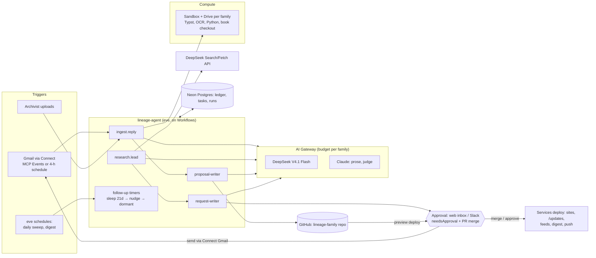

# Lineage on Vercel: migration plan

**Status:** plan, v0.1 (18 October 2026). Owner: Rex St. John. Companion to [PLATFORM-ARCHITECTURE.md](PLATFORM-ARCHITECTURE.md).
**Decision:** run the whole platform (the research agent, the orchestration, the sites and the updates stream) on
Vercel's Agent Stack, with GitHub as the content store and DeepSeek V4.1 Flash as the default model.

Product status below was checked on 18 October 2026 against Vercel's own pages (sources at the end). Items marked
**beta** or **preview** should be re-checked before relying on them in production.

---

## 1. Why Vercel

Everything Lineage already runs is on Vercel (lineage.rexstjohn.com, daniel.rexstjohn.com, `/join/`, `/changelog/`,
subscriptions and the weekly digest). Since mid-2026 Vercel ships a full stack for agents, so the research agent can move
there too, with no separate orchestrator, job runner or OAuth plumbing to maintain.

## 2. What we are migrating (from the hand-run Book of Daniel)

| Job done by hand today | How often | Where it runs now |
|---|---|---|
| Archive-reply check: search Gmail, skip logged, fetch attachments, ingest, log, push | every few hours | Claude Code session on Rex's Mac |
| Ingest a reply: transcribe, record note, dossier, sources, wiki, timeline, chapter, compile | per reply | same session |
| Research agents on new leads (open newspapers, catalogues, crew lists) | several a week | subagents in the session |
| Thank-yous, requests, nudges (drafted, sent on approval) | per reply | same session + Gmail connector |
| Follow-up dates, dormancy | daily | a CSV column and memory |
| Human tasks: browser-only sites, calls, cheques | ongoing | lists in chat |
| Build book, publish sites, changelog, feeds, R2 sync, Drive backup | per edition | shell scripts on the Mac |
| Status dashboard | on request | a Claude artifact, refreshed by hand |

The rules that come with it (citations on every sentence, tiers, contradictions kept, 130-word paragraphs, privacy, never
send/pay/submit without approval, a changelog entry for every site change) move into the agent's instructions and checks.

## 3. The Vercel Agent Stack, mapped

| Need | Vercel product | Status | How Lineage uses it |
|---|---|---|---|
| The agent itself | **eve**, open-source framework: an agent is a folder (`instructions.md`, `agent.ts`, `tools/*.ts`, `skills/*.md`, subagents, channels, schedules), with durable execution, sandboxing, approvals, tracing and evals built in | open source | `lineage-agent` **is** an eve agent; Lineage's existing Markdown skills become eve skills |
| Model access, routing, cost caps | **AI Gateway**: one key for many providers; budgets per key, project, user and team; US-only inference and Zero Data Retention | features announced at Ship 2026 | DeepSeek V4.1 Flash by default (~$0.15/$0.60 per M tokens), Claude for prose and judging; one budget per family; US-only + ZDR for private material |
| Durable runs, timers, approvals | **Workflows** (`'use workflow'`, `'use step'`, `sleep`, hooks) and **WorkflowAgent** (`@ai-sdk/workflow`, tools with `needsApproval: true`) | Workflows GA (2026) | 21-day nudges and dormancy as `sleep`; send/pay/submit tools gated by `needsApproval`; a run waits weeks for an archive at no compute cost |
| Gmail and Drive without expiring tokens | **Vercel Connect**: managed Google connector (Gmail, Drive, Calendar, Sheets); Vercel registers the OAuth app; per-tenant installs; `getToken()` from `@vercel/connect` refreshes automatically | GA (Ship SF) | ends the Testing-mode token expiry; each family's archivist installs once |
| React to new mail | **MCP Events** in Connect (agents respond to events from MCP servers) | public beta | push-style trigger for archive replies; fall back to a 4-hourly schedule until proven |
| Long jobs with real tools (Typst, OCR, Poppler, Python) | **Sandbox** (Pro: sessions up to 24 h, 64 GB NVMe, snapshots) with **Drives** (persistent workspaces: "code, data, and saved memory survive across runs") | Sandbox GA; Drives GA | one Drive per family holds the book checkout, caches and fonts; builds and OCR run there |
| Always-on workers (optional) | **Daemons**: continuous background workers from code or a container image | public beta | not needed at first; useful later for a queue consumer |
| Python scripts | **Python on Vercel** (CPython, PyPI, `uv`, `pyproject.toml`; FastAPI/Flask/Django) | GA | existing `plugins/lineage/scripts/*.py` and intake code run as Python functions or inside Sandbox |
| One deploy for site + API + agent | **Services** (frontend and backend deploy together, with full-app previews) | announced | the Lineage app, approval inbox, updates API and agent endpoints ship as one project |
| Approvals in chat (optional) | **Chat SDK** (Slack/Teams adapters; human-in-the-loop with Workflow) | available | "Approve thank-you to Falmouth PL?" buttons in Slack, beside the web inbox |
| Agent SDK | **AI SDK 7** ("a toolkit for building and running agents", provider-agnostic harness) | announced | the tools and loop under eve |
| Files | **Blob** (or keep **Cloudflare R2**, already holding the book's images and records) | GA | keep R2 for now (sunk cost, cheap egress); private copies stay out of git |
| Database | **Neon Postgres** via the Vercel Marketplace | GA | request ledger, tasks, approvals, runs, subscriptions |
| Schedules | **Cron** / eve `schedules/` | GA | archive check, daily sweep, digest |
| Previews | **Preview deployments** per branch/PR | GA | every proposed change gets a rendered preview of the wiki page and chapter PDF to approve |
| Internal console behind login | **Passport** (identity-provider protection for internal apps) | public beta | optional, for the archivist console |

Not used: Bring Your Own Cloud (enterprise), Token Pass (GLM/Kimi credits; worth a look as a second cheap model).

## 4. Target architecture



## 5. The research agent as an eve agent

Proposed layout of the new repo `lineage-agent` (check against the eve docs when scaffolding; conventions may have moved):

```
lineage-agent/
  instructions.md            the archivist-assistant brief: goals, the rules, the approval policy
  agent.ts                   model routing via AI Gateway, budgets, runtime config
  skills/                    loaded only when relevant
    records-archives.md        (from Lineage plugins/lineage/skills)
    chapter-dossier.md
    published-sources.md
    familypedia-articles.md
    citations-and-tiers.md     (rules: tiers, contradictions kept, date precision, 130 words)
    privacy.md                 (living people, private units/topics, copyright tiers)
    match-criteria.md          (how to accept a record for a person; reads the family's REQUEST briefs)
  tools/                     one file per tool; filename = tool name
    gmail_search.ts            (Connect token)
    gmail_get_message.ts       (streams attachments straight to R2, sha256)
    gmail_send.ts              needsApproval: true
    r2_put.ts / r2_get.ts
    ledger_upsert.ts           (Postgres: institutions, requests, tasks)
    deepseek_search.ts         (POST api.deepseek.com/v1/tools/search; site:/after:/before: operators)
    deepseek_fetch.ts          (only for sites we may open; never for bot-checked sites)
    sandbox_run.ts             (Typst build, OCR, pdftotext inside the family's Drive)
    propose_pr.ts              (branch + PR on the family repo)
    human_task.ts              (creates a call-sheet task with one-line unblock + parameters)
    pay_or_order.ts            always a human task (never executed)
  subagents/
    archive-reply-reader/      transcribe a reply + attachments; find asks
    open-source-researcher/    open archives only; writes negatives
    request-writer/            short specific requests with fee offers
    proposal-writer/           wiki/timeline/chapter diffs within the rules
    page-reader/               vision reading of scans (crew lists, clippings)
    evidence-judge/            per-claim support check, second provider
  schedules/
    archive-check              every 4 h, off-peak for DeepSeek where possible
    daily-sweep                follow-ups due, dormancy, token/budget health, dashboard refresh
  evals/
    frozen-set/                known-correct ingests (demo lineage + consented public-domain records)
```

Each family's repo keeps a `lineage.json` that pins the agent version and sets the model routing and budget:

```json
{
  "tenant": "book-of-daniel",
  "agent": "1.0.0", "spec": "1",
  "models": { "bulk": "deepseek/deepseek-v4.1-flash", "write": "anthropic/claude-sonnet-5-5",
              "judge": ["deepseek/deepseek-v4.1-flash", "anthropic/claude-haiku-5-5"],
              "us_only": true, "zero_data_retention": true, "budget_usd_per_day": 2 },
  "followup_days": 21, "dormant_after_nudge_days": 21,
  "approval": { "auto_send_thank_you": false, "channels": ["web", "slack"] }
}
```

## 6. Models and cost

| Use | Model | Approx. price |
|---|---|---|
| Triage, transcription, record notes, drafting, matching | DeepSeek V4.1 Flash (AI Gateway) | ~$0.15 in / $0.60 out per M tokens |
| Web search and page fetch | DeepSeek Search/Fetch API (direct, same DeepSeek key) | $0.75 per 1,000 successful calls each, billed from 1 Nov 2026; 5 QPS |
| Chapter and Familypedia prose | Claude Sonnet (AI Gateway) | low volume |
| Evidence judge (second provider) | Claude Haiku (AI Gateway) | low volume |
| Scans and handwriting | a vision model via AI Gateway | per scan |
| Long jobs | Sandbox | ~$0.128 per active CPU-hour + memory (Pro) |

Rough estimate for one family (our estimate, to be measured): archive checks ~$0.25/day, research runs ~$0.30–0.60 each,
builds a few CPU-minutes each. Expect tens of dollars a month, not hundreds. AI Gateway budgets enforce the cap per family.

**Privacy:** private material (living relatives, private units and topics, interview transcripts, in-copyright research
copies) is routed only with **US-only inference and Zero Data Retention**, or to Claude. DeepSeek's first-party Search/Fetch
receives queries, not private documents.

## 7. Verification and approvals on Vercel

- **Before a PR exists:** the agent's own checks in Sandbox (compile, 130 words, citation coverage, id uniqueness,
  date precision, privacy scan, changelog entry) and the `evidence-judge` subagent on every new claim.
- **On the PR:** a **preview deployment** renders the changed wiki pages and the chapter PDF, so approval is "look at the
  preview, tap approve". GitHub required checks stay on (a small check job, or Vercel posting commit status).
- **Gated tools:** `gmail_send` (thank-yous, requests, nudges) and anything outward is `needsApproval: true`; the
  WorkflowAgent suspends until approved in the web inbox or Slack, then resumes, sends, logs the thread and starts the
  21-day timer. Payments, logins and bot-checked sites are always human tasks.
- **Evals:** the frozen set runs on every agent release and on any model change (e.g. switching to Flash).

## 8. Migration phases

### Phase 0: accounts and plumbing (2–3 days)
- [ ] Vercel Pro team (Sandbox 24 h sessions, budgets, Connect).
- [ ] **Connect:** install the managed Google connector for rex@verafy.ai (Gmail read/send, Drive). Retires
      `~/.gmail-mcp/verafy` and the Drive token in Book-o-Matic.
- [ ] **AI Gateway:** key, project budget, US-only + ZDR on; confirm DeepSeek V4.1 Flash and Claude models are enabled.
- [ ] **DeepSeek:** account, prepaid balance, key in Vercel env (`DEEPSEEK_API_KEY`) for Search/Fetch.
- [ ] **Neon:** create DB; import `REQUESTS-SENT.md`, `research_catalog.csv` (37 institutions), follow-up dates, call-sheet
      tasks.
- **Exit:** a test function reads Gmail via Connect, calls Flash via the Gateway, runs one DeepSeek search.

### Phase 1: the agent in shadow mode (1 week)
- [ ] Scaffold `lineage-agent` as an eve agent (§5); port the archive-check prompt as `schedules/archive-check`.
- [ ] Port skills from `Lineage/plugins/lineage/skills/` and the rules from the session.
- [ ] Run alongside the current Mac session: the eve agent only writes PRs and drafts; compare its ingests with ours.
- **Exit:** a week of replies where the agent's PRs match what was done by hand, scored against the frozen set.

### Phase 2: workflows, approvals, timers (1 week)
- [ ] Wrap ingest, research, request, follow-up and publish as Workflows; `sleep('21d')` nudges and dormancy.
- [ ] `needsApproval` on send; approval inbox page in the Lineage app; optional Slack via Chat SDK.
- [ ] Gmail trigger via Connect MCP Events (beta); keep the 4-hourly schedule as a fallback.
- **Exit:** a reply arrives → PR + thank-you draft appear within minutes; approving sends it and sets the timer.

### Phase 3: builds and publishing in Sandbox (1 week)
- [ ] A Sandbox image or Drive with Typst, Poppler, Tesseract, Python and the book's fonts.
- [ ] `build_book.sh`, `publish.sh`, `r2_sync.py`, `site_changelog.py`, `posts.py`, `seo_build.py` run there on merge.
- [ ] Preview deployments for every PR; updates feed, digest and Web Push from merged PRs.
- **Exit:** merging a PR publishes the book and sites with the changelog entry, with no Mac involved; the build is
  byte-identical to the hand-run build.

### Phase 4: the Book of Daniel becomes a hosted lineage (1 week)
- [ ] Content-only repo `lineage-book-of-daniel` with `lineage.json` (§5); scripts and `local-overrides/` removed
      (`LINEAGE-DRIFT.md` is the checklist).
- [ ] Retire: the worktree + clone + rsync push path, the Mac's scheduled prompts, `drive_backup.py` tokens, the
      gmail-verafy MCP server.
- [ ] Dashboard reads Neon live (replaces the hand-refreshed artifact).
- **Exit:** two weeks with no Mac session; Rex only approves and does call-sheet tasks.

### Phase 5: many lineages (2 weeks)
- [ ] Tenant #2: the demo lineage; then one real family.
- [ ] Per-family Connect install, Gateway budget, Drive, R2 prefix, domain; onboarding = form + Google install + repo.
- [ ] Archivist referral earnings (Stripe Connect, prototyped on `feature/event-onboarding`).
- **Exit:** two isolated tenants upgraded independently by `lineage.json` pin.

## 9. Retire list

| Retire | Replaced by |
|---|---|
| Claude Code sessions on the Mac as the runner | eve agent on Workflows |
| Scheduled archive-check prompts | `schedules/archive-check` |
| `~/.gmail-mcp/verafy`, gmail-verafy MCP, Drive token re-auths | Vercel Connect (Google) |
| claude.ai Gmail connector size limits | Gmail API via Connect token, attachments streamed to R2 |
| `REQUESTS-SENT.md` / `research_catalog.csv` as the source of truth | Neon (exported to the repo for history) |
| Worktree + bom-clone + rsync | one content repo; PRs |
| Hand-refreshed dashboard artifact | live dashboard on Neon |
| Book-o-Matic `scripts/`, `local-overrides/` | `lineage-agent` tools + `lineage.json` |

## 10. Risks and checks

- **Preview/beta pieces** (MCP Events, Daemons, Passport, parts of Connect): keep a schedule-based fallback; re-check
  status before Phase 2.
- **eve maturity:** it is new; it is open source, so the agent can be forked or moved to plain AI SDK 7 + Workflows if
  needed. Keep tools as plain TypeScript functions.
- **Cheap-model quality:** no switch to Flash without passing the frozen-set evals; keep Claude for prose and as judge.
- **Bot-checked archives** (Cloudflare/WAF): stay human tasks; DeepSeek Fetch must not be used to get round them.
- **Lock-in:** content in git, agent open source, models via a provider-agnostic gateway, files in R2: each layer can move.

## 11. First week for Rex
1. Upgrade/confirm Vercel Pro; enable AI Gateway with a $5/day budget, US-only + ZDR.
2. Connect → install the Google connector for rex@verafy.ai.
3. DeepSeek account, $10 top-up, key into Vercel env.
4. Say "go" on Phase 0 + 1: Claude scaffolds `lineage-agent` (eve), imports the ledger to Neon and runs shadow mode.

## Sources (checked 18 Oct 2026)
- Vercel Ship 2026 recap: https://vercel.com/blog/vercel-ship-2026-recap
- eve: https://vercel.com/eve · https://github.com/vercel/eve
- Workflows: https://vercel.com/docs/workflows · approval stack guide: https://vercel.com/kb/guide/agent-approval-workflow-stack-guide · WorkflowAgent: https://vercel.com/kb/guide/what-is-workflowagent
- Sandbox pricing and quotas: https://vercel.com/docs/sandbox/pricing · duration and persistence: https://vercel.com/kb/guide/vercel-sandbox-duration-and-persistence
- AI Gateway models (DeepSeek V4.1 Flash): https://vercel.com/ai-gateway/models/deepseek-v4.1-flash
- Connect: https://vercel.com/docs/connect · connectors: https://vercel.com/connect/browse
- Chat SDK for Slack agents: https://vercel.com/blog/building-slack-agents-can-be-easy
- DeepSeek Search/Fetch API: https://api-docs.deepseek.com/guides/search · models: https://api-docs.deepseek.com/
