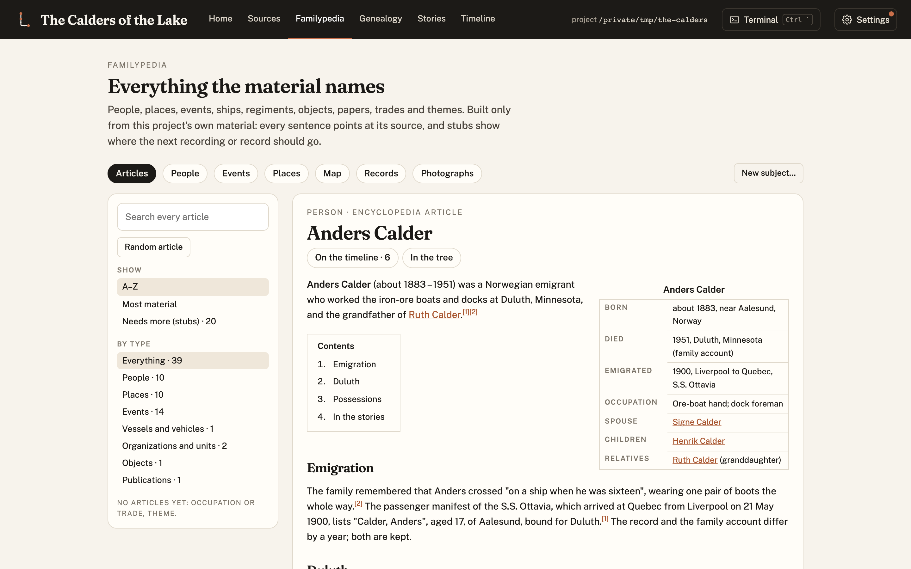

Lineage started as **BookAssembler**: a set of scripts and Claude Code skills that took a recorded
conversation with a relative and turned it into a printed book. The first commit, on 1 October 2026,
did exactly that: transcribe, split the talk into stories, shape them in the speaker's own voice,
and set them in Typst.

It became clear almost at once that the book was the wrong centre. A family's history is not one
recording. It's letters, photographs, a ship's manifest, a census page, a cousin's memory that
contradicts a grandmother's. The book is only one way of reading all of that. So the same day the
project was renamed **Lineage**, and rebuilt around a **record**: plain files in a repository the
family owns, with the book as an export.

## The first day: a dashboard and an encyclopedia

Within that first day Lineage gained a dashboard (Home, Sources, Familypedia, Genealogy, Stories and
Timeline) and the **Familypedia**, an article for every subject the material names. Releases 0.3.0
to 0.5.0 all landed on 1 October: article types for people, places, vessels, organizations and
events; projects that track their Lineage version and update safely; and an invented demo family,
the Calders, with a tour built from real screenshots.

## Learning from a real book

From 5 October, Lineage was used to write a real family's book, and every lesson came back as a
general rule (no family's names or material ever enter Lineage itself):

- **0.6.0** brought the writing rules that made the book trustworthy: every chapter ends with the
  records it rests on, no "general knowledge" sources, generated illustrations always marked, and
  chapter dossiers for research. It also brought the public website and its read-only demo.
- **0.7.0** added a whole-book index, document exhibits, readable editions of court and service
  records, an image catalogue, and publishing a real family's dashboard as a website.
- From 10 October the Familypedia grew portrait cards, People, Events and Places tabs, curated
  encyclopedia articles with numbered references, and image hosting on Cloudflare R2.

## Research, rights and publishing

**0.8.0** (12 October) taught Lineage to clear the rights on a published book before using it, and to
treat it as a secondary source. **0.9.0** moved every publishing step into the core: chapter PDFs,
versioned editions, image hosting, face-centred crops, photo restoration and search-engine pages.
**0.9.1** added private passages, which stay in the record but are never quoted or published, and
shorter paragraphs. The [release notes](2026-10-13-lineage-0-9.md) have the details.

The principle hasn't changed since the first week: **the family's material is the record, every fact
points at its source, and nothing is invented.**
