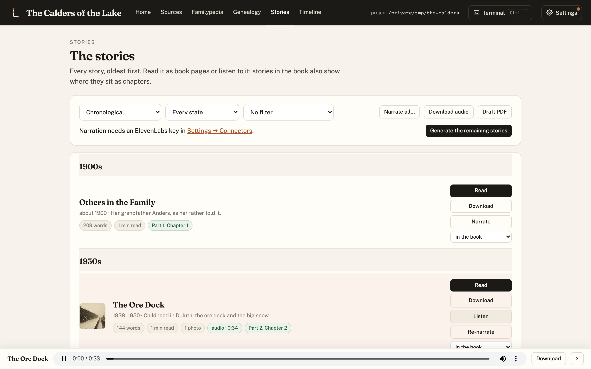
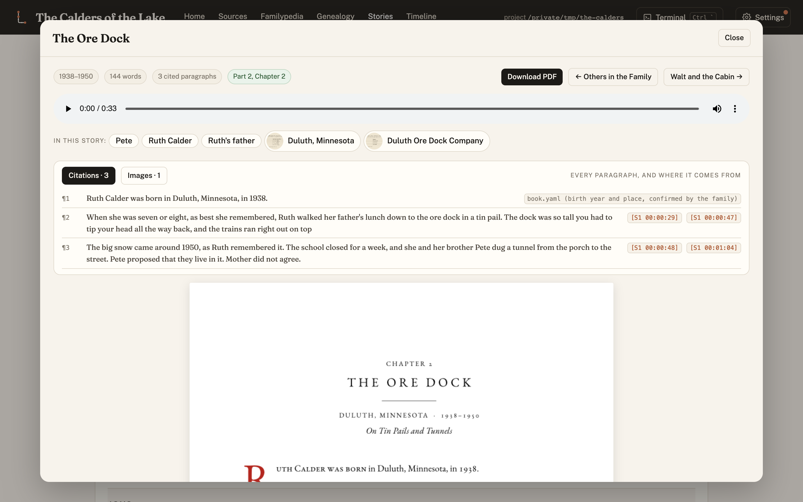
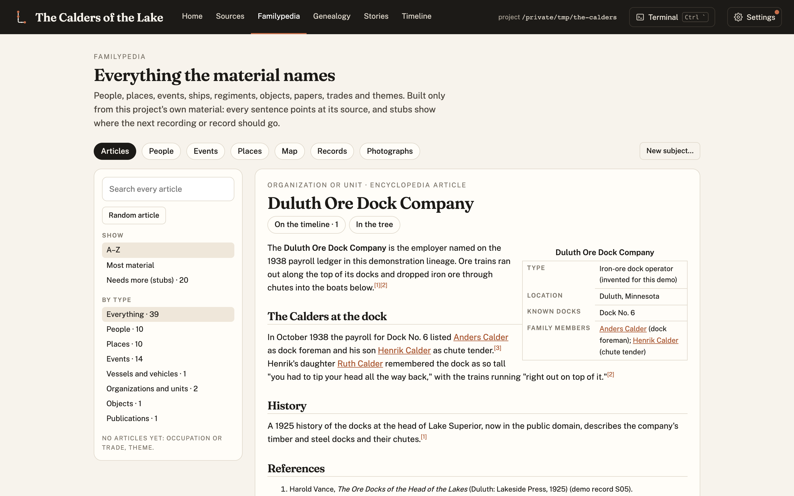

Lineage 0.8, 0.9 and 0.9.1 shipped between 12 and 13 October. They came out of finishing and
publishing a real family's book, and every piece is now part of Lineage for any family.

## Every chapter downloadable

Each story now has a **Download** button on its card and in the reader, serving the chapter as its
own compressed PDF.

## A reader that shows every paragraph's sources

The story reader lists every paragraph with the recordings and records behind it. Before this fix it
merged paragraphs, so stories looked far shorter than they were.

## Encyclopedia articles for anything

Curated Familypedia articles, with an infobox and numbered references, now work for companies,
regiments, ships and places as well as people. `[[Links]]` between them open the right subject.

## Published sources, handled properly

A new `published-sources` skill checks a book's copyright before anything is copied: US public domain
before 1930, and 1930–63 only if the copyright wasn't renewed. Borrowed lending-library copies are
read, never captured. The book becomes a secondary source with page-cited notes, and in-copyright
books are paraphrased, with quotations kept under 15 words. `archive-open-book` downloads open
Internet Archive items and refuses restricted ones.

## Private passages

A story unit marked `private: true` stays in the family's record but is never quoted, indexed or
published. Neither are the stretches of interview it covers. This is for the things a family asks to
keep out.

## Publishing from the core

Everything that turns a record into a public site is now in Lineage, configured per project in
`lineage.json`: chapter PDFs, versioned editions, image hosting on Cloudflare R2, face-centred
crops, classical photo restoration, search-engine pages and an updates page. A folder marked
`.no-drive` is never uploaded anywhere. See [Publishing a family site](../HOWTO.md) in the
how-to guide.

## Shorter paragraphs

Prose paragraphs are now kept under about 130 words. `split_paragraphs.py` reports longer ones and
splits them at sentence ends without changing a word.

The full list is in the [changelog](../../CHANGELOG.md).
