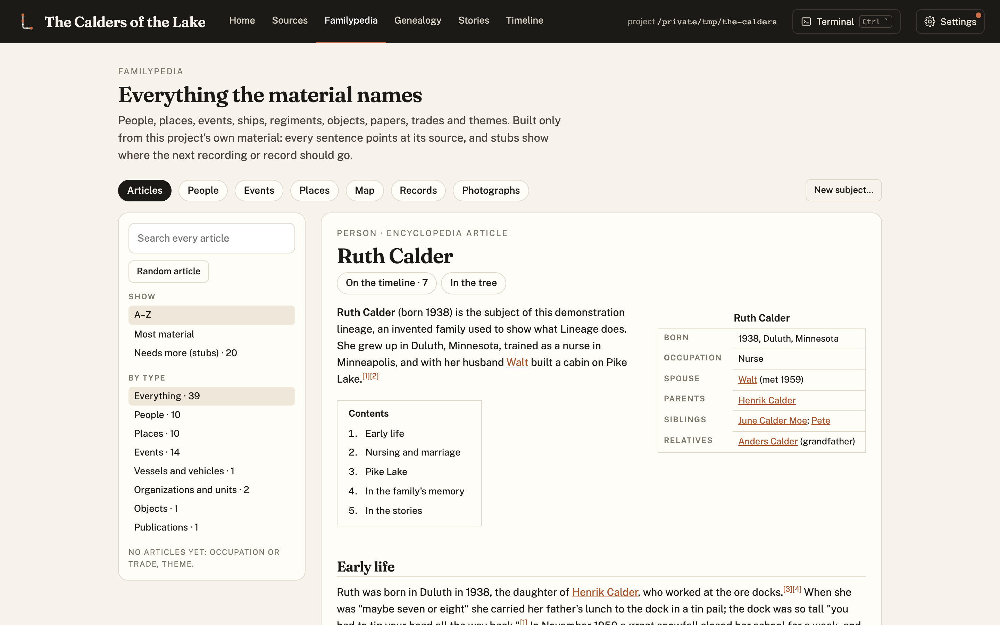

Lineage now has two front doors.

**[Getting started](../../start/)** is for someone who has never used it. It explains what Lineage
is, what you need, and what the first week looks like, with a screenshot of every step.

**[Quickstart](../../quickstart/)** is for getting going. It covers installing Lineage, starting a
family's project, loading it into Claude Code, and then a series of ready-to-paste prompts, drawn
from writing a real family's book, for:

- cataloguing and restoring the photographs and documents the family has;
- sending research agents out for public records, respecting robots.txt, with no logins or
  paywalls;
- checking a published book's copyright before using it;
- **drafting** requests to archives, libraries and museums. Every email waits in your drafts until
  you say "send it";
- watching the inbox for replies and ingesting what arrives;
- writing a Familypedia article and a chapter for each relative, with every paragraph cited;
- keeping private what the family wants kept private, and publishing the rest.

Every prompt keeps the same rule: nothing is sent, paid, published or invented without your approval.
